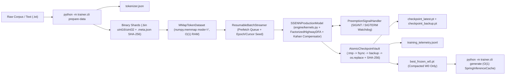

# دليل التدريب الإنتاجي الشامل على السحابة و Google Colab & Drive — SS-ENN v3.0.1
**Comprehensive Production Training Manual for Google Colab, 5TB Google Drive Vaults & Local Acceleration (`v3.0.1`)**

---

## 1. البنية المعمارية لنظام التدريب `v3.0` (`Architecture Overview`)

يجمع الإصدار الثالث **`SS-ENN v3.0`** بين التعلم الموضعي الفيزيائي الخالي تماماً من الانتشار العكسي (`Zero-Autograd`) وبين هندسة تدريب عتادية وسحابية مقاومة للانقطاع المفاجئ:



### الأدوار الأساسية للوحدات الإنتاجية
- **`engine/kernels.py`**: تحديث موضعي مدمج خالٍ من التخصيص (`fused_spring_update_inplace`, `0.00 MB` تحديث للأوزان)، ضرب مقصوص للكتل النشطة، `FactorizedHighwayDFA` لتقليص ذاكرة التوجيه بنسبة حتى `99.20%` عند `V=32,000`، ومعوّض الدقة المختلطة `MixedPrecisionCompensator` (`Kahan FP32`)، وذاكرة الاستدلال $O(1)$ (`SpringInferenceCache`).
- **`models/config_v3.py` & `models/model_v3_production.py`**: ضبط يدوي صريح لكافة الأبعاد (`SSENNConfig`) مع مقدّر بصمة ذاكرة بدون تخصيص (`estimate_memory_footprint()`)، وترسيب مرن نهائي (`Final Elastic Settlement`) داخل `production_freeze()` يضمن مطابقة `Frozen W0` لدقة ما قبل التجميد.
- **`trainer/mmap_dataset.py`**: شرائح ثنائية فائقة السرعة تُقرأ بذاكرة خرائط مقيّدة بـ `O(1)` (`1.93 KB` بيانات وصفية حتى لملايين الرموز وبمعدل تدفق يتجاوز `32M tok/s`) مع استئناف حتمي لموضع الحقبة والدفعة (`get_streamer_state()`).
- **`trainer/checkpoint_vault.py` & `trainer/colab_orchestrator.py`**: حفظ ذري مضاعف الجيل مع بصمة تحقق `SHA-256` وارتداد ذاتي تلقائي إلى `checkpoint_backup.pt` عند تلف الملف الرئيسي، وتصدير غير مدمر لأفضل نسخة مجمّدة (`best_frozen_w0.pt`).
- **`trainer/cli.py`**: بوابة تشغيل موحدة بأربعة أوامر (`estimate`, `prepare-data`, `train`, `generate`).

---

## 2. إعداد بيئة Google Colab وربط مساحة Google Drive

لتفادي ضياع التقدم عند انتهاء مهلة الجلسة المجانية أو فصل مثيل Colab (مثل T4 / L4 / A100)، يُنصح بفصل:
1. **الشيفرة والبيانات المؤقتة السريعة:** على قرص الجلسة `/content/next-23-MTL` و`/content/shards` (سرعة I/O عالية).
2. **خزنة الحفظ الدائمة (`Vault`) والنسخة الاحتياطية للشظايا:** داخل **Google Drive** (`/content/drive/MyDrive/SS_ENN_Vault`).

### الخلية الأولى الجاهزة للنسخ واللصق في Google Colab (`Setup Cell`)

```python
# === الخلية (1): ربط Google Drive، استنساخ المستودع، وفحص العتاد و BF16 ===
from google.colab import drive
drive.mount("/content/drive")

import os, torch
VAULT_ROOT = "/content/drive/MyDrive/SS_ENN_Vault"
SHARDS_BACKUP = "/content/drive/MyDrive/SS_ENN_Shards"
os.makedirs(VAULT_ROOT, exist_ok=True)
os.makedirs(SHARDS_BACKUP, exist_ok=True)

!rm -rf /content/next-23-MTL
!git clone https://github.com/naoufelbvb2-arch/next-23-MTL.git /content/next-23-MTL
%cd /content/next-23-MTL
!pip install -q -r requirements.txt

!nvidia-smi
print("PyTorch:", torch.__version__)
print("CUDA Available:", torch.cuda.is_available())
if torch.cuda.is_available():
    print("GPU:", torch.cuda.get_device_name(0))
    print("BF16 Native Support:", torch.cuda.is_bf16_supported())
```

> [!TIP]
> يدعم الجيل الحديث من بطاقات Colab (`L4 24GB` و `A100 40GB/80GB` و `TPU v5e/v5p`) دقة `bfloat16` فطرياً. أما على بطاقة **`T4 16GB`** (معمارية Turing)، فيمكنك استخدام `--dtype float16` مع تفعيل `--kahan-mode full` تلقائياً لمنع تلاشي التحديثات الصغيرة (`sub-ULP`) وتحقيق تدريب رقمي مستقر.

---

## 3. تجهيز البيانات الضخمة على Google Drive (`prepare-data`)

يقوم الأمر الفرعي `prepare-data` بتدريب/تجهيز `EnglishSubwordTokenizer` (`tokenizer.json`) وتحويل المدونات النصية إلى شظايا ثنائية مضغوطة:
- نوع البيانات تلقائياً **`uint16`** إذا كان `vocab_size <= 65536` (بايتان فقط لكل رمز، أي `2 GB` تخزن **`1 مليار رمز`** بالكامل)، أو **`uint32`** للمفردات الأكبر.
- **تقطيع النصوص الطويلة دون هدر (`v3.0.1 Strided Chunking`):** عندما يتجاوز طول الفقرة أو القصة نافذة `row_stride = seq_len + 1`، يقسّم `BinaryShardBuilder.build_from_stories` التسلسل تلقائياً إلى نوافذ متتالية بخطوة `seq_len` (مع الاحتفاظ بأي ذيل أخير بطول `>= 4` رموز)، فلا تضيع بقية السطور الطويلة في `--input-file`.
- يُحفظ لكل شظية ملف `.meta.json` يتضمن بصمة التحقق **`SHA-256`** للتأكد من سلامة النقل بين SSD و Google Drive.

### أ. تجهيز بياناتك النصية الخاصة (أو مدونة القصص المدمجة للاختبار السريع)

```bash
# 1) تحويل ملف نصي ضخم على Google Drive إلى شظايا ثنائية سريعة محلياً (أو على Drive مباشرة)
python -m trainer.cli prepare-data \
  --input-file /content/drive/MyDrive/datasets/english_corpus.txt \
  --out-dir /content/drive/MyDrive/SS_ENN_Shards/run_32k \
  --vocab-size 32000 \
  --seq-len 128 \
  --train-ratio 0.95

# 2) أو تجربة سريعة باستعمال مدونة TinyStories المدمجة في المستودع
python -m trainer.cli prepare-data \
  --builtin-tinystories \
  --out-dir /content/shards_demo \
  --vocab-size 2048 \
  --seq-len 36 \
  --target-min-tokens 20000
```

> [!NOTE]
> عند التشغيل على Google Colab مع ملفات شظايا كبيرة الحجم على Google Drive، انسخ مجلد الشظايا في بداية الجلسة إلى قرص Colab المحلي (`/content/local_shards`) لبلوغ سرعة قراءة تقارب **`32M+ tok/s`** باستهلاك ذاكرة ثابت لا يتجاوز **`~1.93 KB`** بيانات وصفية و **`< 1 MB`** لمخزن القراءة المسبقة، مع الإبقاء على `--vault-dir` داخل Google Drive لضمان نجاة الحفظ الدائم.

---

## 4. دليل ضبط الأبعاد اليدوية (`Manual Scaling Guide — From 15M to 7B+`)

جميع الأرقام التالية محسوبة حرفياً عبر `SSENNConfig.estimate_memory_footprint()` (يمكنك إعادة التحقق من أي تركيبة يدوياً عبر `python -m trainer.cli estimate`). تأكد دائماً أن `d_init` و`d_max` و`delta_d` مضاعفات للكتلة `--block-size` (الافتراضي `16`) وأن `top_k_blocks <= d_init // block_size`.

### جدول الأحجام المرجعي (`d_max`, `Kahan FP32`, `Frozen W0`, `Accelerator`)

| فئة النموذج | `vocab_size` | `L` (`num_layers`) | `d_init -> d_max` | `delta_d` | `B / K_blk` | `T_max` | `dtype` / `kahan_mode` | إجمالي المعاملات (`Max Train`) | أوزان + `Kahan FP32` | حجم النشر (`Frozen W0`) | توفير DFA | البطاقة الموصى بها |
| :--- | :---: | :---: | :---: | :---: | :---: | :---: | :---: | ---: | ---: | ---: | :---: | :--- |
| **`15M` (حافة/CPU)** | `6,144` | `6` | `192 -> 384` | `32` | `16 / 4` | `512` | `bfloat16` / `full` | `15.09M` | `71.0 MB` (`0.069 GB`) | **`12.8 MB`** | `93.75%` | **CPU / Colab T4 16GB** |
| **`125M` (أساسي)** | `16,384` | `12` | `512 -> 1024` | `128` | `16 / 8` | `1024` | `bfloat16` / `full` | `132.12M` | `624.0 MB` (`0.609 GB`) | **`102.0 MB`** | `93.75%` | **Colab T4 16GB (or L4 24GB)** |
| **`350M` (متوسط صغير)** | `32,000` | `16` | `768 -> 1536` | `128` | `16 / 12` | `1024` | `bfloat16` / `full` | `379.85M` | `1.758 GB` (`1.05 GB Kahan`) | **`289.5 MB`** | `95.20%` | **Colab T4 16GB (or L4 24GB)** |
| **`1.3B` (متوسط)** | `32,000` | `24` | `1536 -> 3072` | `256` | `16 / 16` | `2048` | `bfloat16` / `full` | `1.43B` | **`6.606 GB`** (`3.95 GB Kahan`) | **`927.0 MB`** | `90.40%` | **Colab T4 16GB (or L4 24GB)** |
| **`3B` (كبير متوسط)** | `32,000` | `28` | `2048 -> 4352` | `256` | `16 / 24` | `2048` | `bfloat16` / `full` | `2.93B` | **`13.582 GB`** (`8.12 GB Kahan`) | **`1.73 GB`** | `86.40%` | **Colab L4 24GB (or A100 40GB)** |
| **`7B` (ضخم — `full`)** | `32,000` | `32` | `3072 -> 6656` | `512` | `16 / 32` | `2048` | `bfloat16` / `full` | `7.11B` | **`32.957 GB`** (`19.71 GB Kahan`) | **`3.95 GB`** | `79.20%` | **Colab A100 40GB (or A100 80GB)** |
| **`7B` (`anchor_k -33%`)** | `32,000` | `32` | `3072 -> 6656` | `512` | `16 / 32` | `2048` | `bfloat16` / **`anchor_k`** | `7.11B` | **`26.387 GB`** (**`13.14 GB`** Kahan) | **`3.95 GB`** | `79.20%` | **Colab A100 40GB (or A100 80GB)** |

> [!IMPORTANT]
> **متى تختار `kahan_mode="full"` ومتى تختار `kahan_mode="anchor_k"`؟**
> - استخدم **`kahan_mode="full"`** لجميع النماذج حتى **`3B`**، حيث تتوافر سعة VRAM كافية للاحتفاظ بمتبقيات `FP32` الثلاث (`_res_w`, `_res_w0`, `_res_k`)؛ مما يمنح أقصى دقة تراكمية للصلابات والأوزان في `BF16/FP16`.
> - استخدم **`kahan_mode="anchor_k"`** في النماذج العملاقة **`7B+`** عند التدريب على بطاقة `A100 40GB`: يقوم هذا الوضع بإسقاط مخزن `_res_w` والاحتفاظ بمتبقيات `(w0, k)` فقط لأن المرساة $W_0$ والصلابة $k$ هما المسؤولان عن حفظ المعرفة بعيدة المدى والضبط الدقيق، مما يخفض استهلاك معوّض `Kahan` بنسبة **`33.3%`** (`19.71 GB -> 13.14 GB`) ويحرر **`6.57 GB`** كاملة لمخازن التفعيلات والسياق الطويل.

### أمثلة الفحص المسبق والإطلاق العملي من سطر الأوامر (`CLI Recipes`)

```bash
# 1. حساب البصمة مسبقاً لنموذج 1.3B قبل حجز الـ GPU
python -m trainer.cli estimate \
  --vocab-size 32000 --num-layers 24 --d-init 1536 --d-max 3072 --delta-d 256 \
  --block-size 16 --top-k-blocks 16 --max-seq-len 2048 --attn-top-k 16 \
  --dtype bfloat16 --kahan-mode full --device cuda

# 2. حساب البصمة لنموذج 7B مع ترشيد الذاكرة بوضع anchor_k (-33.3% Kahan RAM)
python -m trainer.cli estimate \
  --vocab-size 32000 --num-layers 32 --d-init 3072 --d-max 6656 --delta-d 512 \
  --block-size 16 --top-k-blocks 32 --max-seq-len 2048 --attn-top-k 16 \
  --dtype bfloat16 --kahan-mode anchor_k --device cuda

# 3. إطلاق التدريب الإنتاجي المقاوم للانقطاع على Colab GPU مع خزنة Drive
# ملاحظات v3.0.1:
#  - يستنتج train طول السياق `--seq-len` تلقائياً من `.meta.json` عند إغفاله، ويرفع `--max-seq-len` تلقائياً مع تنبيه إذا كان أصغر من الشظية.
#  - القيمة الافتراضية `--sleep-every-epochs 0` مناسبة للتدريب التأسيسي الموحد؛ وعند تفعيل النوم الدوري يُنصح بضبط `--sleep-min-epoch` لحماية الحقب المبكرة من القفل الميكانيكي المبكر.
python -m trainer.cli train \
  --data-dir /content/local_shards \
  --vault-dir /content/drive/MyDrive/SS_ENN_Vault/exp_125m \
  --num-layers 12 --d-init 512 --d-max 1024 --delta-d 128 \
  --block-size 16 --top-k-blocks 8 --max-seq-len 1024 --attn-top-k 12 \
  --dtype bfloat16 --kahan-mode full --device cuda \
  --epochs 20 --batch-size 32 --ckpt-every-steps 100 --sleep-every-epochs 0 \
  --auto-resume
```

---

## 5. إدارة التدريب، التعافي الذاتي من انقطاع Colab، والمراقبة الحية

### 5.1 آلية الحفظ الذري والنسخة الاحتياطية (`AtomicCheckpointVault`)
عند كل حفظ دوري (`--ckpt-every-steps` أو `--ckpt-every-seconds`) أو عند نهاية حقبة أو التقاط إشارة إنهاء (`SIGTERM`/`SIGINT`):
1. تُجمع الحالة الكاملة بالبتّ: مصفوفات الأوزان، متبقيات `Kahan` بمفاتيحها النصية الحتمية، حالة مولّد `RNG`، مؤشر تدفق البيانات `ResumableBatchStreamer` (`epoch`, `batch_cursor`, `epoch_rng_seed`)، وحتى **مجمعات خسارة الحقبة الجارية** (`epoch_accum`) كي لا تنحرف قرارات `Neurogenesis` في نهاية الحقبة.
2. يُغلف الحمل الرقمي ببصمة تحقق **`SHA-256`** ويُكتب إلى ملف مؤقت `.tmp` متبوعاً بـ `flush()` و `os.fsync()` حتى يُفرَّغ فعلياً على وحدة التخزين / Google Drive.
3. قبل استبدال `checkpoint_latest.pt`، يُتحقق من سلامة النسخة السابقة السليمة وتُنسخ ذرياً إلى **`checkpoint_backup.pt`**، ثم يجري تبديل ذري عبر `os.replace()`.
4. **ماذا لو انقطعت جلسة Colab أو تلف `checkpoint_latest.pt`؟**
   عند إعادة تشغيل نفس أمر `train --auto-resume` في جلسة جديدة:
   - إن كان `checkpoint_latest.pt` سليماً، يستأنف من **نفس الدفعة التالية داخل الحقبة** (`0.00e+00` فارق أوزان).
   - إن تعرض `checkpoint_latest.pt` للقطع أثناء المزامنة مع Drive أو عطب في البتات (`truncate` / `bitflip`)، يكتشف `AtomicCheckpointVault` التناقض في `SHA-256` دون أن ينهار البرنامج ويرتد تلقائياً إلى **`checkpoint_backup.pt`** ويسجل حدث `"corrupt_checkpoint_fallback"` في السجل الحي.

### 5.2 مراقبة التقدم عبر `training_telemetry.jsonl`
يُلحَق كل حدث رئيسي كسطر JSON مستقل داخل `<vault-dir>/training_telemetry.jsonl`. يمكنك استعراضه حياً من Colab:

```python
import json, pathlib
log_path = pathlib.Path("/content/drive/MyDrive/SS_ENN_Vault/exp_125m/training_telemetry.jsonl")
for line in log_path.read_text(encoding="utf-8").splitlines()[-10:]:
    rec = json.loads(line)
    print(rec.get("event"), {k: v for k, v in rec.items() if k not in ("event", "timestamp")})
```

أنواع الأحداث القياسية المسجلة:
- `periodic_checkpoint`: رقم الحقبة، الدفعة التالية `next_batch_cursor`، الخطوة العالمية `global_step`، وزمن الحفظ `save_ms`.
- `epoch_end`: `train_acc_pct`, `train_ce`, `val_acc_pct`, `val_ppl`, الأبعاد الفعالة `active_dims`, وهل توسعت الشبكة `grew`.
- `best_frozen_w0_exported`: يُطلق تلقائياً عند تسجيل أعلى `val_acc_pct`، حيث يستنسخ نسخة معزولة ويجمدها (`Final Elastic Settlement + prune_dormant`) إلى `best_frozen_w0.pt` دون إيقاف التدريب الحي.
- `emergency_preemption_save` / `corrupt_checkpoint_fallback` / `checkpoint_resumed` / `sleep_consolidation`.

### 5.3 التوليد الفوري من النموذج المجمّد `best_frozen_w0.pt` بذاكرة $O(1)$

بعد اكتمال التدريب (أو أثناءه فور تصدير أول `best_frozen_w0.pt`)، شغّل الاستدلال المضغوط فوراً بذاكرة `SpringInferenceCache`:

```bash
python -m trainer.cli generate \
  --vault-dir /content/drive/MyDrive/SS_ENN_Vault/exp_125m \
  --tokenizer /content/drive/MyDrive/SS_ENN_Vault/exp_125m/tokenizer.json \
  --prompt "Once upon a time" \
  --max-new-tokens 60 \
  --device cpu
```

> [!TIP]
> لوجود `Production Freeze` و `prune_dormant=True`، يُضغط حجم النموذج المصدَّر `best_frozen_w0.pt` بتجريده الكامل من `w` و `k` و `FactorizedHighwayDFA` و `MixedPrecisionCompensator`؛ فمثلاً يتحول نموذج **`1.3B` (`6.606 GB` أثناء التدريب)** إلى ملف استدلال رشيق بحجم **`927 MB`** فقط، ونموذج **`7B` (`26.39 GB` مع `anchor_k`)** إلى **`3.95 GB`** فقط يعمل على بطاقات استهلاكية أو خوادم خفيفة بذاكرة حالة ثابتة $O(1)$.
